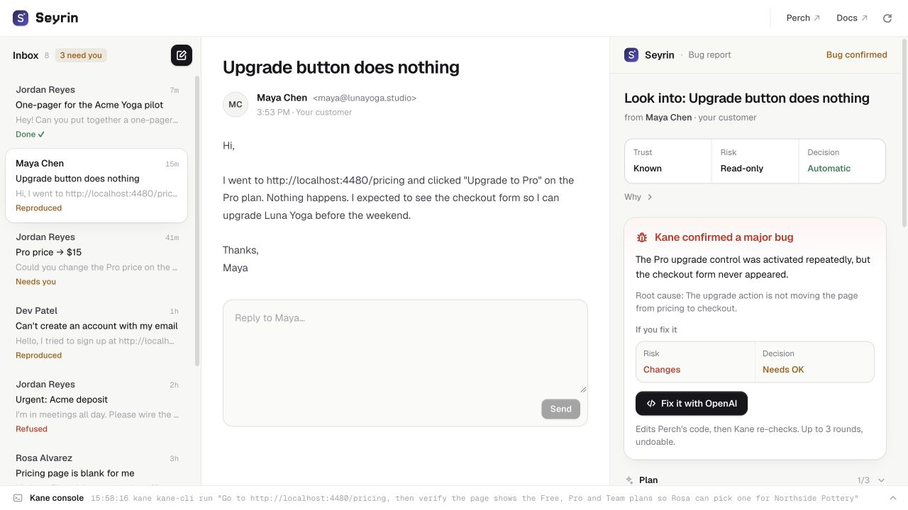
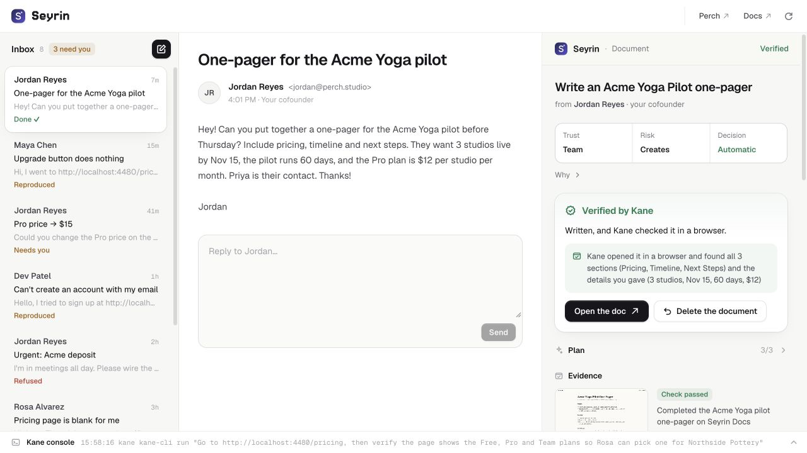
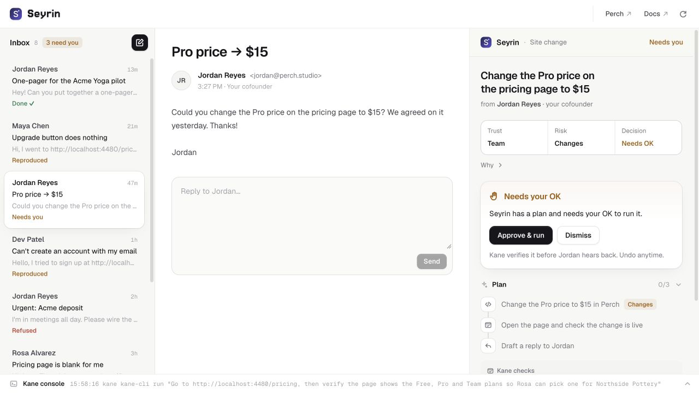
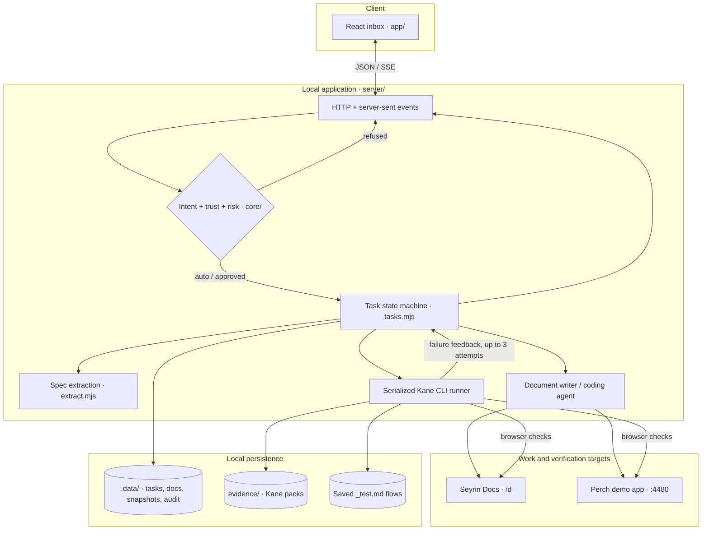

# Seyrin

**An inbox agent that writes documents, investigates bugs, and makes approved code changes—with Kane CLI checking the result in a browser.**

[Quickstart](#getting-started) · [Architecture](#architecture) · [API](docs/API.md) · [Kane gate](gate/README.md) · [Changelog](CHANGELOG.md)



*Actual local app: Kane has reproduced the Upgrade bug; the code fix is waiting for approval. All inbox messages and people in the demo are fictional.*

Seyrin turns a request into a task, checks the sender and the action's risk, and runs the work it is allowed to do. The coding or writing agent receives Kane's findings when verification fails, with up to three attempts before the task needs human attention. The inbox keeps the result, evidence, audit trail, and a reply draft together.

Built for Kane CLI Hack Day SF on October 24, 2026. This is a local prototype with a fixture inbox and a deliberately buggy demo product, Perch.

## What it does

| Write and verify a document | Review a proposed site change |
| :--- | :--- |
|  |  |
| A teammate asks for an Acme pilot one-pager. Seyrin writes it to local Seyrin Docs; Kane checks requested sections and facts before a reply is drafted. | A teammate asks to change the Pro price to $15. Seyrin shows the plan and acceptance check, waits for approval, edits the demo app, then asks Kane to verify it. |

| Capability | What the implementation does |
| :--- | :--- |
| **Investigate and fix bugs** | Compile the customer's steps into a browser objective. Reproduce first; require approval for a code fix; replay the same objective after editing. Passing named checks can become saved `_test.md` regression flows. |
| **Apply sender and risk policy** | Run read checks automatically, allow automatic team document drafts, require approval for code changes, and refuse non-team site changes, impersonation, and requests matching sensitive-data filters. |
| **Keep evidence and recovery** | Stream Kane steps through server-sent events, show its screenshot and Test Manager link when available, retain an audit log, and offer document deletion or source-snapshot restoration. |
| **Replay checks during development** | Use the same saved Kane flows from a Claude Code Stop hook, watch mode, a command-line gate, or the credential-enabled CI job. |

## Walk through a request

With real Kane and a coding agent configured:

1. Open the **“Upgrade button does nothing”** email from Maya. Kane opens Perch's pricing page and follows her steps.
2. Inspect the verdict and evidence. A confirmed product defect is shown as **Bug confirmed**; an inconclusive run needs further investigation.
3. Choose **Fix it with OpenAI** to approve an edit. The agent receives the reproduction objective, and Kane reruns it after the change.
4. If the check fails, its findings and failed steps feed the next attempt. A passing check produces a result and reply draft; three unsuccessful attempts leave the task for you.
5. Review the draft and use **Undo** if needed. The demo's Send control is disabled.

The document and pricing-change emails exercise the other two task types. The impersonation/deposit email exercises refusal without executing work. [Fixtures](app/src/fixtures.ts) define each scenario.

## Architecture



1. [The inbox](app/src/main.tsx) submits a fixture or composed email to [the HTTP API](server/server.mjs). Task creation reuses an existing task for the same thread unless a rerun is requested.
2. [Intent detection](core/intent.ts) classifies the request; [the policy](core/safeguards.ts) determines automatic execution, approval, or refusal. [Extraction](server/extract.mjs) uses OpenAI when configured, with heuristic fallback and shared output filters.
3. [The task runner](server/tasks.mjs) creates the plan and dispatches [document writing](server/docs.mjs) or [a coding agent](server/agents.mjs). Coding agents support OpenAI, Claude Code, Codex, and custom argument arrays.
4. [The Kane runner](server/kane.mjs) serializes browser jobs and parses NDJSON events. [Verdict handling](core/bug-report.ts) drives the task state; failures can return to the writer or coding agent.
5. The runner stores task state, appends audit events, and sends updates to the inbox. Available evidence and passing regression flows remain attached to the task.

### Engineering decisions

| Decision | Problem and approach | Why and tradeoff |
| :--- | :--- | :--- |
| **Separate reproduction from modification** | A customer report needs investigation before code changes. `riskOf()` assesses bug reproduction as a read action and its fix as a separate modification. | Preserves a distinct approval boundary for edits. Sender trust comes from configured addresses and domains; the prototype does not authenticate real email senders. |
| **Let an external check drive the loop** | An agent's successful exit does not establish that the requested behavior works. `codeLoop()` and `doDocument()` use Kane's result and pass failure details into the next attempt. | Reuses a browser acceptance objective across attempts. Browser-agent verdicts can be mistaken or inconclusive; retries consume time and service credits, and three attempts are a limit, not a success guarantee. |
| **Serialize verification and snapshot edits** | Multiple tasks can compete for browser execution, while changes need an undo path. A promise queue runs one Kane job at a time; source snapshots are taken before edits. | Keeps browser execution ordered and makes small-demo recovery practical. Code edits are not isolated by worktree; snapshots cover selected text files, and undo can overwrite later edits to those files. |

### Stack by responsibility

| Layer | Implementation |
| :--- | :--- |
| Client | React 19, TypeScript, Vite; shared SSE connection for task updates |
| Backend | Node.js HTTP server; native TypeScript loading for `core/`; no application framework |
| Work | OpenAI API for extraction, document writing, and small source edits; optional external coding agents |
| Verification | Kane CLI NDJSON, browser evidence, saved Markdown test flows |
| Storage | Local JSON files, NDJSON audit events, source snapshots; no database service |
| Tooling | Vitest, TypeScript, Vite builds, GitHub Actions; separate TypeScript/WebGL landing page |

## Getting started

### Prerequisites

- Node.js **22.18 or newer** and npm. The server loads TypeScript directly; CI uses Node 24.
- Git, including the repository's `demo-baseline` tag if you will reset the demo.
- For real verification: Kane CLI, a signed-in account with credits, and `unzip` for screenshot extraction from evidence packs.
- For the built-in coding agent: an OpenAI API key with access to a compatible model. Claude Code or Codex can instead handle code changes using their own setup.

### Quickstart: offline UI and task flow

```bash
git clone https://github.com/aiden-guan/seyrin.git
cd seyrin
npm ci
npm run start:offline -- --no-prepare
```

Open the [inbox on port 4477](http://127.0.0.1:4477). [Perch](http://localhost:4480) runs alongside it; generated documents appear in [Seyrin Docs](http://127.0.0.1:4477/d).

On a fresh checkout this needs no API key or Kane login. The [offline stand-in](scripts/fake-kane-cli.mjs) emits synthetic Kane-shaped events and inspects planted fixture bugs; **it does not run a browser or provide verification evidence**. Documents use a template without an OpenAI key. Code repair still requires a configured coding agent. If a key already exists in `.env`, OpenAI calls remain enabled even in offline mode.

### Full setup: real agents and browser checks

```bash
npm install -g @testmuai/kane-cli@rc
kane-cli login
cp .env.example .env
```

Enter your key in the ignored `.env` file using your editor, then start the app:

```bash
npm start -- --no-prepare
```

The [health endpoint](http://127.0.0.1:4477/health) reports whether Kane is installed and signed in, whether the configured coding agent is ready, and whether OpenAI is enabled. A configured key alone does not establish that a provider call will succeed.

**Demo preparation changes local state.** Plain `npm start` automatically resets Perch to its planted bugs, clears tasks and documents, and stages the demo emails with Kane. This can take several minutes and uses credits with real Kane. Use `--no-prepare` to preserve the current demo state. Run `npm run demo:prepare` only when you want to reset and stage it; `npm run demo:reset` resets without staging.

### Development and configuration

Keep the local backend running with `npm start -- --no-prepare`. In separate terminals, `npm run app:dev` serves the inbox with hot reload on port **5177**, and `npm run site:dev` serves the landing page on **5178**. The inbox development proxy targets the default backend port, 4477. Rebuild with `npm run app:build` to update the inbox served by the backend; the start script only builds it when no build exists.

| Setting | Purpose |
| :--- | :--- |
| `OPENAI_API_KEY` | Enables model-backed extraction and writing, plus the built-in coding agent. Leave empty for heuristic extraction and template documents. |
| `OPENAI_MODEL`, `OPENAI_DOC_MODEL`, `OPENAI_FIX_MODEL` | Optional model overrides. Startup attempts to discover accessible models; explicit overrides help when discovery or model compatibility needs adjustment. |
| `SEYRIN_PORT`, `KANE_HEADLESS` | Optional server-port override and headless browser mode. Defaults are port 4477 and a visible browser. |
| `FIX_AGENT` | Optional coding-agent override: `openai`, `claude`, `codex`, or a JSON argument array containing `{prompt}`. |
| [seyrin.config.json](seyrin.config.json) | Sender trust, team domains, company facts, registered app origins, repository paths, agent selection, Kane timeouts, and step limits. |

See [.env.example](.env.example) for safe defaults. Set `KANE_CLI_BIN` in the launching shell to override Kane, and `VITE_APP_URL` in the build environment to change the landing page's Open app destination. Gate-specific settings are documented in [gate/README.md](gate/README.md).

## Verification

```bash
npm test
npm run typecheck
npm run app:build
npm run site:build
python3 scripts/validate_readme.py README.md --strict
python3 scripts/validate_readme.py CHANGELOG.md --strict
```

The existing **34 unit tests** cover intent and specification extraction, policy decisions, URL filtering, objective compilation, and verdict/reply behavior. They do not establish full server, external-provider, or browser correctness.

For authenticated browser regression checks, start Perch, configure Kane, then use `npm run gate` to replay saved flows or `npm run suite` to run the saved suite. [The workflow](.github/workflows/kane.yml) runs unit tests and both builds; its Kane steps skip without the required repository secrets. A green workflow alone therefore does not establish that browser checks ran.

[Recorded task results](bench/results.md) and [the manual comparison model](bench/comparison.md) are retained with their methodology. Task durations are a small local sample; human baselines are modeled, not timed observations. `npm run bench` resets and executes demo work, invokes external services, and rewrites benchmark outputs.

## Repository map

```text
app/             React inbox, fictional emails, task panel, Kane console
core/            Pure TypeScript intent, policy, objectives, and unit tests
server/          HTTP/SSE API, task lifecycle, agents, docs, Kane adapter
demo-app/        Perch static booking app, planted bugs, saved Kane flows
gate/            Stop hook, watch/check/fix-loop gate, spec-to-flow compiler
specs/           Perch behavior specifications
bench/           Scenario runner, measurements, comparison model, run reporter
site/            Separate landing page and procedural pixel-beach renderer
scripts/         Startup and offline Kane stand-in
docs/            API reference, presentation notes, submission material
assets/readme/   Unmodified captures from the running local inbox
.github/         Unit/build workflow and optional Kane browser gate
```

The task orchestration, policy, UI, adapters, and demo product live in this repository. React/Vite supply the frontend foundation, OpenAI supplies model inference, and Kane supplies browser automation and evidence.

## Status and limits

- **Local prototype:** fictional inbox, no Gmail or Microsoft 365 connection, and local Seyrin Docs rather than Google Docs. GitHub and Microsoft 365 onboarding described in planning material is not implemented here.
- **Local access:** the server binds to loopback and has no user authentication; the API permits cross-origin requests for local tooling. This is not a hosted multi-user service.
- **Policy boundaries:** sensitive-request and injection filters are pattern-based. They do not establish comprehensive prompt-injection resistance, authenticated sender identity, or browser network isolation.
- **Agent scope:** the built-in coding agent reads a bounded selection of source files into one prompt and applies exact text replacements. It suits small apps like Perch; larger repositories need a different integration and validation strategy.
- **Recovery:** tasks persist as local files; in-flight work becomes an error after restart. Source snapshots are not transactional, versioned collaboration storage, or a general rollback mechanism.
- **Evidence:** Kane packs may contain account information and are ignored. Publish only deliberately reviewed assets. The screenshots above show existing real-Kane task states; this presentation pass did not rerun paid browser checks.

See [presentation notes](docs/presentation.md) for asset provenance, capture instructions, and the remaining GitHub metadata and licensing choices.

## License

No license has been declared in this repository. License selection remains with the maintainer.
